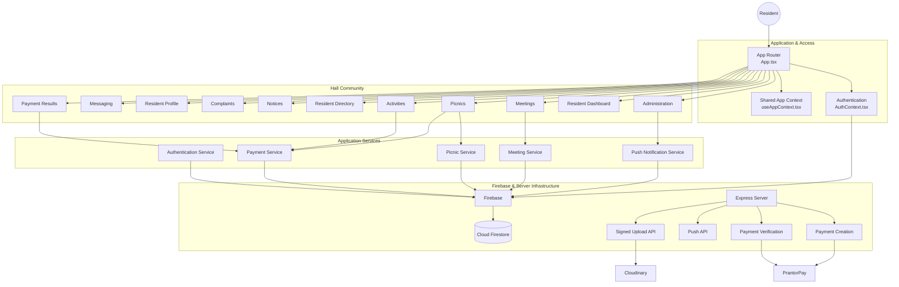

# 🏠 DIU Hall Connect

### Daffodil International University Residential Hall Management Platform

[](https://diuhall.vercel.app/)
[](https://github.com/mdalfishahor/diuhall)
[](https://react.dev/)
[](https://www.typescriptlang.org/)
[](https://firebase.google.com/)
[](https://vite.dev/)
[](https://tailwindcss.com/)

> **DIU Hall Connect** is a full-stack residential hall management and community platform designed for students living in university halls. It brings resident services, announcements, meetings, activities, complaints, payments, messaging, notifications, and administration into one digital platform.

**Live Application:** https://diuhall.vercel.app/
**Source Code:** https://github.com/mdalfishahor/diuhall


[](https://gitdiagram.com/mdalfishahor/diuhall?utm_source=readme&utm_medium=picture)
---

## 📌 Table of Contents

* [Overview](#-overview)
* [Problem](#-problem)
* [Solution](#-solution)
* [Core Features](#-core-features)
* [How the Platform Works](#-how-the-platform-works)
* [User Roles](#-user-roles)
* [Architecture](#-architecture)
* [Technology Stack](#-technology-stack)
* [Project Structure](#-project-structure)
* [Authentication Flow](#-authentication-flow)
* [Data & Firestore](#-data--firestore)
* [Payment Architecture](#-payment-architecture)
* [Push Notifications](#-push-notifications)
* [Media Uploads](#-media-uploads)
* [Security](#-security)
* [Environment Variables](#-environment-variables)
* [Local Development](#-local-development)
* [Production Build](#-production-build)
* [Deployment](#-deployment)
* [Adding a New Feature](#-adding-a-new-feature)
* [Architecture Diagram](#-architecture-diagram)
* [Use Cases](#-use-cases)
* [Business / Institutional Value](#-business--institutional-value)
* [Future Expansion](#-future-expansion)
* [Limitations & Important Notes](#-limitations--important-notes)
* [Contributing](#-contributing)
* [License](#-license)
* [Author](#-author)

---

# 🎯 Overview

DIU Hall Connect is a centralized digital platform for managing and improving the day-to-day experience of university residential hall residents.

Instead of relying on separate communication channels, paper notices, manual registrations, informal messaging groups, and disconnected payment processes, the platform provides a single web application for residents and hall administrators.

The platform is designed around three major areas:

### 👨‍🎓 Resident Experience

Students can:

* Create an account
* Manage their profile
* View hall information
* Read notices
* Participate in meetings
* Join picnics
* Participate in activities
* Submit complaints
* Browse the resident directory
* Communicate through direct and group messaging
* Receive notifications
* Make online payments for supported paid activities

### 🏢 Hall Administration

Administrators can:

* Manage residents
* Publish notices
* Manage meetings
* Manage picnics
* Manage activities
* Monitor complaints
* Send notifications
* Manage administrative data
* Handle payment-related workflows
* Manage hall-wide communication

### ⚙️ Platform Infrastructure

The application uses:

* React + TypeScript
* Firebase Authentication
* Cloud Firestore
* Firebase Cloud Messaging
* Express.js
* Vite
* Tailwind CSS
* PrantorPay payment integration
* Cloudinary signed uploads
* Optional Gemini API integration

---

# ❗ Problem

University residential halls often depend on multiple disconnected systems:

```text
Notice Board
     +
Messenger / WhatsApp Groups
     +
Manual Registration
     +
Paper Complaints
     +
Separate Payment Process
     +
Informal Student Directory
     +
Manual Notifications
```

This creates problems such as:

* Information being scattered across different channels
* Students missing important announcements
* Difficulty organizing hall events
* Manual participant registration
* Poor complaint tracking
* No centralized resident information
* Difficult payment management
* Limited administrative visibility
* Communication becoming difficult as the hall grows

DIU Hall Connect addresses these problems by bringing the major workflows into a single platform.

---

# 💡 Solution

The platform creates a digital hall ecosystem:

```text
                    DIU Hall Connect
                           │
          ┌────────────────┼────────────────┐
          │                │                │
       Residents       Community        Administration
          │                │                │
     ┌────┴────┐      ┌────┴────┐      ┌────┴────┐
     │ Profile │      │ Meetings│      │ Notices │
     │ Directory│     │ Picnics │      │Complaints│
     │ Payments│      │Activities│     │ Push Msg │
     │ Messaging│     │Community│      │ Management│
     └─────────┘      └─────────┘      └─────────┘
                           │
                     Firebase Backend
                           │
              ┌────────────┼────────────┐
              │            │            │
           Auth         Firestore     FCM
              │
        Server APIs
              │
       ┌──────┴───────┐
       │              │
   PrantorPay     Cloudinary
```

---

# 🚀 Core Features

## 🔐 Authentication

Residents can register and sign in using Firebase Authentication.

The authentication system supports:

* Email/password registration
* Email/password login
* Password reset
* Persistent authentication state
* Logout
* User profile loading
* Role-based access

New registrations are assigned the `student` role by default.

The authentication layer also caches the current resident profile to improve resilience when Firestore is temporarily unavailable.

---

## 👤 Resident Profiles

Each resident has a profile containing information such as:

* Name
* Email
* Profile photo
* Batch information
* Department/batch information
* Role
* Account creation information

The profile is stored in Firestore under:

```text
users/{userId}
```

---

## 📢 Notices

Administrators and authorized users can publish hall notices.

Residents can access centralized announcements instead of relying entirely on external communication groups.

Typical use cases:

* Hall announcements
* Event information
* Important deadlines
* Administrative messages
* General resident communication

---

## 🗓️ Meetings

The meeting system allows residents to organize and respond to meetings.

A meeting can contain:

* Title
* Date
* Creator
* Resident responses
* Attendance status
* Optional response reasons

Meeting responses are stored as a subcollection:

```text
meetings/{meetingId}/responses/{userId}
```

Private response reasons have additional access restrictions so they can be viewed by the relevant resident, meeting creator, or administrator.

The Firestore rules explicitly enforce these ownership and access conditions.

---

## 🧺 Picnics

Residents can create and participate in hall picnics.

The picnic workflow supports:

* Picnic creation
* Place
* Participant registration
* Participant management
* Optional payment
* Administrative management

Participant information is organized under:

```text
picnics/{picnicId}/participants/{userId}
```

---

## 🎯 Activities

The platform supports activities that can be either free or paid.

Activities can contain:

* Title
* Description
* Fee
* Creator
* Registration/order information
* Custom form fields
* Payment status

Paid activities use the payment system described later in this document.

---

## 💳 Online Payments

DIU Hall Connect integrates with **PrantorPay** for supported online payments.

The payment architecture is deliberately server-mediated.

The browser does not directly receive sensitive gateway credentials.

### Payment Flow

```text
Resident
   │
   │ Selects paid activity
   ▼
Frontend
   │
   │ Firebase ID Token
   ▼
POST /api/payment/create
   │
   ▼
Server
   │
   │ Validates user/activity
   │
   │ Creates payment
   ▼
PrantorPay
   │
   │ Payment URL
   ▼
Resident
   │
   │ Completes payment
   ▼
Payment Gateway
   │
   │ Redirect
   ▼
Payment Result
   │
   ▼
POST /api/payment/verify
   │
   ▼
Server
   │
   ▼
Firestore
```

The frontend obtains the Firebase ID token and sends it to the server when creating or verifying a payment. Payment results can be `paid`, `pending`, `failed`, or `cancelled`.

---

## 🔔 Push Notifications

The platform supports Firebase Cloud Messaging-based notifications.

Push notification infrastructure is used for:

* Hall announcements
* Administrative broadcasts
* Activity-related communication
* Scheduled reminders
* Resident notifications

Device subscriptions are associated with resident UIDs and stored in Firestore.

The backend exposes:

```text
POST /api/send-push
```

for push notification delivery.

---

## 💬 Messaging

The platform includes a messaging system supporting:

* Direct 1-to-1 conversations
* Group conversations
* Text messages
* Image messages
* System messages
* Message reactions
* Read state
* Deleted-for-user state
* Typing indicators

The Firestore security model restricts chat access to participants.

A user must be a participant in a conversation before accessing its messages.

---

## 📝 Complaints

Residents can submit complaints through the platform.

A complaint contains:

* Title
* Description
* Creator
* Status/administrative handling information

The security rules validate complaint ownership and restrict certain administrative actions.

This provides a foundation for replacing informal complaint reporting with a trackable digital workflow.

---

## 👥 Resident Directory

The resident directory allows authenticated users to discover other residents.

This can be useful for:

* Finding hall residents
* Community building
* Communication
* Identifying batch/departments
* Starting conversations

---

# 🔄 How the Platform Works

A typical resident journey looks like this:

### 1. Registration

```text
Resident
   ↓
Registration Page
   ↓
Firebase Authentication
   ↓
Firebase User Account
   ↓
Firestore User Profile
   ↓
Resident Dashboard
```

New accounts receive the default:

```text
role = "student"
```

The registration flow also initializes or updates hall-wide settings such as the newest batch when applicable.

---

### 2. Authentication

When the application starts:

```text
Application
    ↓
AuthContext
    ↓
Firebase Auth Listener
    ↓
Authenticated?
   / \
 No   Yes
 │     │
Login  Load Profile
 │     │
 └─────┘
     ↓
Application Context
     ↓
Protected Pages
```

---

### 3. Resident Dashboard

After authentication, the resident can access the major hall services:

```text
Dashboard
├── Notices
├── Meetings
├── Picnics
├── Activities
├── Directory
├── Complaints
├── Messaging
├── Profile
└── Notifications
```

---

### 4. Creating Community Content

For a feature such as a meeting:

```text
Meeting Page
      ↓
Meeting Form
      ↓
meetingService.ts
      ↓
Firebase
      ↓
Firestore
      ↓
Meeting Available
      ↓
Residents Respond
```

This service-oriented architecture keeps feature logic separate from UI components.

---

# 👥 User Roles

The application currently uses role-based access.

## Student

The default role for newly registered residents:

```text
student
```

Students can interact with resident-facing features according to the Firestore security rules.

---

## Administrator

Administrators have additional permissions.

Administrative permissions are enforced at the Firestore security-rule level rather than relying only on frontend UI restrictions.

An administrator can manage areas such as:

* Residents
* Notices
* Meetings
* Picnics
* Activities
* Complaints
* Notifications
* Administrative data

The Firestore rules support administrator detection through the user's authenticated email or an administrator role stored in the user document.

---

# 🏗️ Architecture

DIU Hall Connect follows a layered architecture:

```text
┌───────────────────────────────────────────────┐
│                  React UI                     │
│                                               │
│  Pages • Components • Forms • Navigation      │
└──────────────────────┬────────────────────────┘
                       │
                       ▼
┌───────────────────────────────────────────────┐
│             Application State                 │
│                                               │
│ AuthContext • AppContext • Hooks              │
└──────────────────────┬────────────────────────┘
                       │
                       ▼
┌───────────────────────────────────────────────┐
│                  Services                     │
│                                               │
│ Auth • Meetings • Picnics • Payments          │
│ Push Notifications • Firestore Operations     │
└───────────────┬───────────────────┬───────────┘
                │                   │
                ▼                   ▼
       ┌────────────────┐   ┌──────────────────┐
       │    Firebase    │   │   Express APIs   │
       │                │   │                  │
       │ Auth           │   │ Payment Create   │
       │ Firestore      │   │ Payment Verify   │
       │ FCM            │   │ Push             │
       │ Analytics      │   │ Upload Signing   │
       └────────────────┘   └────────┬─────────┘
                                     │
                          ┌──────────┴──────────┐
                          │                     │
                     PrantorPay            Cloudinary
```

---

# 🛠️ Technology Stack

| Technology               | Purpose                              |
| ------------------------ | ------------------------------------ |
| React 19                 | Frontend UI                          |
| TypeScript               | Type-safe application development    |
| Vite                     | Frontend tooling and build system    |
| Tailwind CSS 4           | Styling                              |
| React Router             | Application routing                  |
| Firebase Authentication  | User authentication                  |
| Cloud Firestore          | Application database                 |
| Firebase Cloud Messaging | Push notifications                   |
| Firebase Analytics       | Application analytics                |
| Express.js               | Server/API layer                     |
| Firebase Admin SDK       | Server-side Firebase operations      |
| PrantorPay               | Online payment processing            |
| Cloudinary               | Signed media uploads                 |
| Motion                   | UI animation                         |
| Lucide React             | Icons                                |
| Gemini API               | AI-related application functionality |

The current repository dependencies include React, React DOM, React Router, Firebase, Firebase Admin, Express, Cloudinary, Vite, Tailwind CSS, Motion, Lucide React, and Google's GenAI SDK.

---

# 📁 Project Structure

The project is organized into frontend pages, reusable services, application state, and server APIs.

```text
diuhall/
│
├── api/
│   ├── payment/
│   │   ├── create.ts
│   │   └── verify.ts
│   │
│   ├── upload/
│   │   └── sign.ts
│   │
│   └── send-push.ts
│
├── public/
│
├── src/
│   ├── components/
│   │
│   ├── context/
│   │   └── AuthContext.tsx
│   │
│   ├── hooks/
│   │   └── useAppContext.tsx
│   │
│   ├── pages/
│   │   ├── AdminPage.tsx
│   │   ├── HomePage.tsx
│   │   ├── MeetingsPage.tsx
│   │   ├── MeetingDetailPage.tsx
│   │   ├── PicnicsPage.tsx
│   │   ├── ActivitiesPage.tsx
│   │   ├── CreateActivityPage.tsx
│   │   ├── DirectoryPage.tsx
│   │   ├── NoticesPage.tsx
│   │   ├── ComplaintsPage.tsx
│   │   ├── ProfilePage.tsx
│   │   └── PaymentResultPage.tsx
│   │
│   ├── services/
│   │   ├── authService.ts
│   │   ├── meetingService.ts
│   │   ├── picnicService.ts
│   │   ├── paymentService.ts
│   │   └── pushService.ts
│   │
│   ├── App.tsx
│   ├── firebase.ts
│   └── ...
│
├── firestore.rules
├── server.ts
├── package.json
├── tsconfig.json
├── vite.config.ts
├── vercel.json
├── .env.example
└── README.md
```

The repository currently contains separate `api`, `public`, and `src` areas along with Firebase configuration, Firestore rules, `server.ts`, Vite configuration, and deployment configuration.

---

# 🔐 Authentication Flow

Authentication is handled by Firebase Authentication.

### Login

```text
Email + Password
       ↓
Firebase Authentication
       ↓
Firebase UID
       ↓
users/{uid}
       ↓
Resident Profile
       ↓
AuthContext
       ↓
Application
```

### Registration

```text
Registration Form
       ↓
Firebase createUserWithEmailAndPassword()
       ↓
Generate UID
       ↓
Create Resident Object
       ↓
users/{uid}
       ↓
role = student
```

Firebase Authentication and Firestore are intentionally separated:

```text
Firebase Auth
    │
    └── Identity / Credentials

Firestore
    │
    └── Resident Profile / Application Data
```

---

# 🗄️ Data & Firestore

Cloud Firestore is the primary application database.

Major collections include:

```text
users
blocks
settings
meetings
picnics
notices
complaints
notifications
pushSubscribers
pushLogs
pendingPayments
activities
chats
```

Some features also use nested subcollections.

Example:

```text
meetings/
└── {meetingId}/
    ├── responses/
    │   └── {userId}
    │
    └── reasons/
        └── {userId}
```

Messaging:

```text
chats/
└── {chatId}/
    ├── messages/
    │   └── {messageId}
    │       └── reactions/
    │
    └── typing/
```

Activities:

```text
activities/
└── {activityId}/
    └── orders/
        └── {userId}
```

The repository includes dedicated Firestore security rules with a default-deny rule for unknown documents.

---

# 🛡️ Security Model

Security is handled at multiple layers.

## 1. Firebase Authentication

Only authenticated users can access protected resident functionality.

---

## 2. Firestore Security Rules

The rules use functions such as:

```text
isSignedIn()
isOwner()
isAdmin()
isValidId()
isChatParticipant()
```

This allows access policies to be enforced directly by Firestore.

The rules start with:

```text
allow read, write: if false;
```

for unknown documents.

This creates a default-deny posture for collections that are not explicitly configured.

---

## 3. Ownership Validation

For user-owned resources, the platform validates the authenticated UID.

Example concept:

```text
request.auth.uid == resourceOwner
```

This prevents users from arbitrarily modifying another user's records.

---

## 4. Server-Side Secrets

Sensitive credentials are intended to remain server-side.

For example:

```text
PRANTORPAY_API_KEY
PRANTORPAY_SECRET_KEY
PRANTORPAY_BRAND_KEY

CLOUDINARY_API_SECRET

FIREBASE_SERVICE_ACCOUNT_B64
```

These should never be exposed to browser-side JavaScript.

The repository's environment template explicitly marks the payment and Cloudinary secrets as server-only.

---

# 💳 Payment Architecture

Payment processing is intentionally separated from the frontend.

The server exposes:

```text
POST /api/payment/create
POST /api/payment/verify
```

The frontend sends a Firebase authentication token:

```http
Authorization: Bearer <firebase-id-token>
```

The server validates the request before communicating with the payment gateway.

This design avoids putting gateway secret keys into frontend code.

The payment service also stores temporary payment information locally so the application can recover the correct payment result route after a gateway redirect.

---

# 🔔 Push Notification Architecture

The notification system consists of:

```text
Resident Browser
       │
       ▼
Firebase Cloud Messaging
       │
       ▼
Device Subscription
       │
       ▼
Firestore
       │
       ▼
Admin / Server
       │
       ▼
Push Delivery API
```

The backend exposes:

```text
POST /api/send-push
```

Push subscriptions are associated with resident accounts, allowing notifications to target individual users or broader groups.

---

# 🖼️ Media Upload Architecture

Media uploads use a signed-upload approach.

The application exposes:

```text
POST /api/upload/sign
```

The server generates the required signing information while keeping the Cloudinary API secret server-side.

The general flow is:

```text
Browser
   │
   │ Request upload signature
   ▼
Express API
   │
   │ Uses Cloudinary credentials
   ▼
Signed Upload Information
   │
   ▼
Browser
   │
   ▼
Cloudinary
```

This avoids exposing the Cloudinary API secret in the browser.

---

# 🌐 Server Architecture

`server.ts` provides the Express server layer.

It handles:

```text
/api/health

/api/send-push

/api/payment/create

/api/payment/verify

/api/upload/sign
```

It also serves the frontend in production and integrates Vite middleware during development.

The health endpoint is:

```http
GET /api/health
```

Expected response:

```json
{
  "status": "ok"
}
```

---

# 🔑 Environment Variables

Create a local `.env` file based on:

```text
.env.example
```

The current project defines configuration for:

```env
GEMINI_API_KEY=
APP_URL=

FIREBASE_SERVICE_ACCOUNT_B64=
SITE_URL=

PRANTORPAY_API_KEY=
PRANTORPAY_SECRET_KEY=
PRANTORPAY_BRAND_KEY=

CLOUDINARY_CLOUD_NAME=
CLOUDINARY_API_KEY=
CLOUDINARY_API_SECRET=
```

The repository specifically documents Gemini, application URL, Firebase Admin credentials, PrantorPay credentials, and Cloudinary credentials in `.env.example`.

### Important

Never commit:

```text
.env
```

or any file containing:

```text
API keys
Secret keys
Service account credentials
Private credentials
Production payment credentials
```

Use `.env.example` as a template only.

---

# 💻 Local Development

## Prerequisites

Install:

* Node.js
* npm, Bun, or another compatible package manager
* Firebase project
* Required server-side credentials for features you want to run locally

The repository currently contains a `bun.lock` file, while the package scripts are standard Node-based scripts.

---

## 1. Clone the Repository

```bash
git clone https://github.com/mdalfishahor/diuhall.git
cd diuhall
```

---

## 2. Install Dependencies

Using npm:

```bash
npm install
```

Or using Bun:

```bash
bun install
```

---

## 3. Configure Environment Variables

Create:

```text
.env
```

based on:

```text
.env.example
```

Example:

```env
GEMINI_API_KEY=your_key

APP_URL=http://localhost:3000

FIREBASE_SERVICE_ACCOUNT_B64=your_service_account

SITE_URL=http://localhost:3000

PRANTORPAY_API_KEY=your_key
PRANTORPAY_SECRET_KEY=your_secret
PRANTORPAY_BRAND_KEY=your_brand_key

CLOUDINARY_CLOUD_NAME=your_cloud
CLOUDINARY_API_KEY=your_key
CLOUDINARY_API_SECRET=your_secret
```

Only configure the integrations you actually intend to use.

---

## 4. Configure Firebase

Create a Firebase project and configure:

* Firebase Authentication
* Cloud Firestore
* Firebase Cloud Messaging
* Firebase Analytics if required

Then configure the client Firebase settings in:

```text
src/firebase.ts
```

For a new deployment, replace the existing project's Firebase configuration with the configuration belonging to your own Firebase project.

---

## 5. Apply Firestore Rules

The repository includes:

```text
firestore.rules
```

Deploy the rules to your Firebase project before using the application in production.

---

## 6. Start Development Server

```bash
npm run dev
```

The application uses the Express server with Vite development middleware.

By default, the server listens on:

```text
http://localhost:3000
```

The development server configuration is defined in `server.ts`.

---

# 🏭 Production Build

Create a production build with:

```bash
npm run build
```

The build performs two operations:

```text
Vite frontend build
        +
esbuild server bundle
        ↓
Production application
```

The current package configuration builds the frontend with Vite and bundles `server.ts` into:

```text
dist/server.cjs
```

The production server can then be started with:

```bash
npm start
```

These commands are defined directly in the repository's `package.json`.

---

# ☁️ Deployment

The project is currently deployed at:

**https://diuhall.vercel.app/**

The repository includes:

```text
vercel.json
```

and a server/API architecture designed for deployment.

A typical production setup is:

```text
GitHub
   │
   ▼
Vercel
   │
   ├── Frontend
   │
   └── API/Server Functions
          │
          ├── Firebase
          ├── PrantorPay
          ├── Cloudinary
          └── FCM
```

Before production deployment, configure all required environment variables in the deployment platform.

---

# 🧩 Adding a New Feature

The project follows a service-oriented structure.

For example, to add a new community feature:

### Step 1: Create the page

```text
src/pages/NewFeaturePage.tsx
```

### Step 2: Create the service

```text
src/services/newFeatureService.ts
```

### Step 3: Add routing

Update:

```text
src/App.tsx
```

### Step 4: Add application state if required

Update:

```text
src/hooks/useAppContext.tsx
```

or the appropriate context.

### Step 5: Add Firestore rules

Update:

```text
firestore.rules
```

### Step 6: Add server endpoint if sensitive credentials are required

Create:

```text
api/new-feature/
```

and register the endpoint through the server architecture.

### Step 7: Test

Check:

```text
Authentication
Authorization
Firestore rules
Frontend behavior
Mobile responsiveness
Server API
Error handling
```

---

# 🗺️ Architecture Diagram



---

# 🔁 Feature-to-Service Mapping

| Feature          | Frontend                  | Service                | Backend / Infrastructure |
| ---------------- | ------------------------- | ---------------------- | ------------------------ |
| Authentication   | Auth pages                | `authService.ts`       | Firebase Auth            |
| Resident Profile | `ProfilePage.tsx`         | Auth/Profile logic     | Firestore                |
| Meetings         | `MeetingsPage.tsx`        | `meetingService.ts`    | Firestore                |
| Picnics          | `PicnicsPage.tsx`         | `picnicService.ts`     | Firestore                |
| Activities       | `ActivitiesPage.tsx`      | Activity/payment logic | Firestore + API          |
| Payments         | `PaymentResultPage.tsx`   | `paymentService.ts`    | Express + PrantorPay     |
| Notifications    | Admin                     | `pushService.ts`       | FCM + API                |
| Complaints       | `ComplaintsPage.tsx`      | Firestore logic        | Firestore                |
| Directory        | `DirectoryPage.tsx`       | Firestore logic        | Firestore                |
| Messaging        | Messaging UI              | Messaging logic        | Firestore                |
| Media            | Profile/activity features | Upload logic           | Cloudinary               |
| Administration   | `AdminPage.tsx`           | Multiple services      | Firebase/API             |

---

# 🏫 Use Cases

DIU Hall Connect can be adapted for:

### University Residential Halls

* Student registration
* Hall announcements
* Resident directory
* Meetings
* Events
* Complaints
* Payments
* Notifications

### Hostels

The same architecture can be adapted for private hostels.

### Student Housing

Useful for:

* Resident communication
* Event management
* Issue reporting
* Payment collection

### Residential Communities

The platform can be generalized into a broader community-management system.

---

# 💼 Business / Institutional Value

DIU Hall Connect demonstrates how a traditional administrative environment can be transformed into a centralized digital workflow.

### For Institutions

Potential benefits include:

* Reduced manual administration
* Centralized resident information
* Faster communication
* Digital complaint handling
* Easier event management
* Online payment support
* Better notification delivery
* Structured resident data

### For Residents

Potential benefits include:

* One account for hall services
* Faster access to information
* Easier event participation
* Digital complaint submission
* Community communication
* Online payments
* Centralized notifications

### For Developers

The project demonstrates:

* Full-stack TypeScript development
* React architecture
* Firebase integration
* Firestore security rules
* Authentication
* Server-side API design
* Payment gateway integration
* Push notifications
* Cloud media uploads
* Production deployment

---

# 📈 Scalability & Extension

The architecture is designed so additional services can be added without rewriting the entire application.

Potential future modules include:

```text
Room Management
      │
      ├── Room Allocation
      ├── Seat Management
      └── Vacancy Tracking

Maintenance
      │
      ├── Repair Requests
      ├── Maintenance Status
      └── Staff Assignment

Dining
      │
      ├── Meal Booking
      ├── Meal Cancellation
      └── Dining Payments

Visitor Management
      │
      ├── Visitor Registration
      ├── Approval
      └── Entry Logs

Emergency Management
      │
      ├── Emergency Contacts
      ├── Alerts
      └── Incident Reports
```

---

# 🔮 Future Expansion

Possible future improvements include:

* Multi-hall support
* Multi-campus support
* Advanced administrator dashboard
* Resident analytics
* Room allocation
* Hall seat management
* Maintenance ticketing
* Visitor management
* Digital ID integration
* More payment gateways
* Automated reminders
* Advanced notification targeting
* Audit logs
* Exportable administrative reports
* Progressive Web App improvements
* Mobile applications
* Institutional SSO integration
* More granular permission management

The current architecture already separates authentication, services, pages, server APIs, and database security, making these extensions easier to introduce incrementally.

---

# ⚠️ Limitations & Important Notes

## Firebase Configuration

The repository currently contains a Firebase client configuration in:

```text
src/firebase.ts
```

When deploying your own instance, use your own Firebase project and configuration rather than reusing another deployment's backend.

---

## Administrator Configuration

The current Firestore security rules contain an administrator email alongside role-based administrator access.

If you fork this project, review and replace the administrator configuration in:

```text
firestore.rules
```

before using the system for your own institution.

---

## Payment Gateway

Online payment functionality depends on correctly configured PrantorPay server credentials.

Without valid payment configuration, payment-related functionality will not operate.

The application already handles several payment configuration and gateway failure conditions, including missing configuration, invalid authentication, unavailable activities, and gateway errors.

---

## Firebase Costs and Quotas

The platform relies heavily on Firestore.

Production deployments should monitor:

* Firestore reads
* Firestore writes
* Authentication usage
* Messaging usage
* Storage
* Cloud/hosting costs

The application includes handling for Firestore quota/offline conditions, but proper Firebase project sizing and monitoring are still important.

---

# 🤝 Contributing

Contributions are welcome.

A typical contribution workflow:

```bash
# Fork the repository

git clone <your-fork-url>

cd diuhall

npm install

git checkout -b feature/my-feature

# Make your changes

npm run lint

npm run build

git add .

git commit -m "feat: add my feature"

git push origin feature/my-feature
```

Then open a Pull Request.

### Before submitting a PR

Please verify:

* TypeScript compiles
* Production build succeeds
* Firestore rules remain secure
* No secrets are committed
* Existing features continue working
* Responsive layouts are maintained
* Error states are handled
* Authentication/authorization is respected

---

# 📜 License

Add the project's chosen license here.

For example:

```text
MIT License
```

if you decide to distribute the project under the MIT License.

> If this repository does not yet contain a `LICENSE` file, choose and add an appropriate license before presenting the project as formally open-source.

---

# 👨‍💻 Author

## Md Alfi Shahor

Computer Science & Engineering Student
Daffodil International University

### Links

* 🌐 Portfolio: https://alfishahor.pro.bd
* 💻 GitHub: https://github.com/mdalfishahor
* 💼 LinkedIn: https://linkedin.com/in/alfishahor
* 📘 Facebook: https://facebook.com/alfishahor29

---

# 🌐 Project Links

| Resource          | Link                                    |
| ----------------- | --------------------------------------- |
| Live Application  | https://diuhall.vercel.app/             |
| GitHub Repository | https://github.com/mdalfishahor/diuhall |

---

# ⭐ Why This Project Matters

DIU Hall Connect is more than a collection of CRUD pages.

It is an example of turning a real institutional workflow into a connected software platform.

The project combines:

```text
Real-world Problem
       ↓
User-centered Web Application
       ↓
Authentication
       ↓
Database Architecture
       ↓
Role-based Security
       ↓
Community Features
       ↓
Payment Infrastructure
       ↓
Push Notifications
       ↓
Media Infrastructure
       ↓
Production Deployment
```

The goal is simple:

> **Make university residential hall management more connected, organized, and accessible through one digital platform.**

---

## 🚀 Live Demo

**Try DIU Hall Connect:**
https://diuhall.vercel.app/

**View the source code:**
https://github.com/mdalfishahor/diuhall
